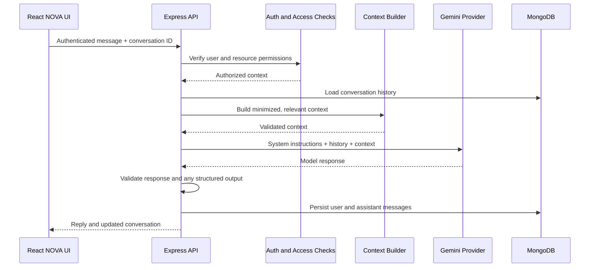

# Forma AI Assistant — NOVA Architecture

## 1. Identity

NOVA is the existing AI assistant identity inside Forma AI. The product-facing capability may be described as **Forma Assistant, powered by NOVA**, but the existing NOVA name should not be removed without a deliberate product decision.

## 2. Current implementation

The development work has implemented and locally tested:
- Gemini-backed chat through the Express backend.
- Floating assistant on authenticated application pages, hidden on the dedicated assistant route.
- Full-page assistant workspace.
- Shared MongoDB-backed conversations between both interfaces.
- Conversation creation and retrieval.
- Conversation search by title.
- Conversation rename through the conversation update API.
- Conversation deletion with a custom confirmation interface.
- Rename and deletion persistence after refresh.
- Markdown rendering using React Markdown and remark-gfm.
- Navigation between floating and full-page interfaces with conversation context.

These are development-session verification results. They are not a substitute for automated tests or production monitoring.

## 3. Target assistant capabilities

### General workspace help
Explain application features, navigation, and form concepts.

### Form assistance
- Suggest field types and labels.
- Recommend validation rules.
- Improve wording and form structure.
- Explain conditional logic.
- Review a selected form schema.

### AI form generation
- Convert natural-language requirements into a structured form schema.
- Validate the result against an explicit server-side schema.
- Preview generated fields in Form Builder.
- Require user review and approval before saving or publishing.

### Submission insights
- Summarize authorized submission datasets.
- Identify patterns and common responses.
- Generate explanations of computed metrics.
- Highlight data limitations and sample sizes.
- Avoid exposing individual sensitive responses unnecessarily.

### Context awareness
Context may include:
- Current route/page.
- Selected form ID.
- A minimized, permission-checked form schema.
- Selected date range.
- Aggregated submission statistics.

Never send all workspace data by default. The backend must verify access and select only the minimum relevant context.

## 4. Target request flow



## 5. Provider architecture

- Gemini is the currently active NOVA provider in the backend implementation.
- Provider credentials stay in backend environment variables.
- OpenAI-related packages and environment placeholders may remain for future optional provider support, but they are not the active NOVA path.
- Do not send requests to a paid provider without an explicit product decision and cost controls.
- Provider selection should eventually be isolated behind a service interface rather than embedded in route handlers.

## 6. Structured form generation contract

The model should return data matching a server-defined schema, not arbitrary executable code.

Example conceptual shape:

```json
{
  "title": "Employee Registration",
  "description": "Employee details form",
  "fields": [
    {
      "name": "fullName",
      "label": "Full name",
      "type": "text",
      "required": true
    },
    {
      "name": "email",
      "label": "Work email",
      "type": "email",
      "required": true
    }
  ]
}
```

This is an illustrative contract, not a claim that the current FormBuilder accepts this exact shape. Confirm the actual form schema before implementing generation.

Validation requirements:
- Allowlisted field types.
- Unique and safe field identifiers.
- Length and count limits.
- Valid options for choice fields.
- Supported validation rules only.
- No arbitrary scripts, HTML execution, or model-supplied database operations.
- User preview and approval before persistence.

## 7. Conversation management

Current capabilities: create, list, retrieve, rename, delete, and persist messages.

Future enhancements:
- Pin and archive conversations.
- Export conversations.
- Copy and regenerate responses.
- Stop generation.
- Response feedback.
- Better search across message content.
- Clear all history with explicit confirmation.
- Conversation context labels and related form references.

## 8. Reliability and safety

- Authenticate all private assistant endpoints.
- Enforce ownership/workspace access for conversation and form IDs.
- Apply per-user rate limits and message size limits.
- Handle provider quota, timeout, and unavailable errors distinctly.
- Avoid logging prompts or sensitive data unnecessarily.
- Do not treat model output as trusted instructions.
- Validate structured model output before using it.
- Keep user messages and assistant messages clearly distinguished.
- Explain when an answer is based on incomplete or aggregated data.

## 9. Theme and accessibility

Both floating and full-page NOVA must use shared semantic theme tokens. Support keyboard operation, accessible labels, readable Markdown, code/table overflow, reduced motion, and mobile layouts.

## 10. Acceptance criteria for future AI features

- [ ] Context is built server-side from authorized resources.
- [ ] Cross-workspace access attempts are rejected.
- [ ] Structured outputs are schema-validated.
- [ ] AI-generated forms require review.
- [ ] Submission analysis uses real, authorized data.
- [ ] Provider errors and quota limits have useful UI states.
- [ ] Sensitive information is minimized.
- [ ] Theme and responsive behaviour are consistent.
