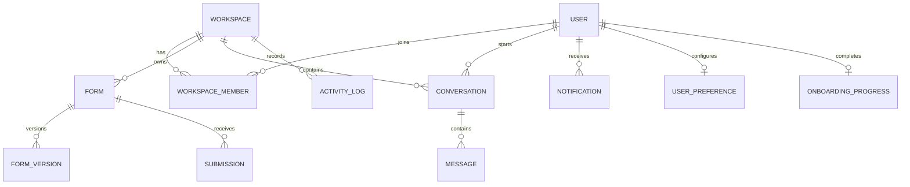

# Forma AI — Data Model and Domain Boundaries

## 1. Purpose

This document defines the target domain model for evolving Forma AI from a primarily user-owned form application into a workspace-ready SaaS product.

It is a design target, not a statement that every collection or relationship already exists in MongoDB. Inspect current Mongoose schemas and records before migrations.

## 2. Core entities

| Entity | Purpose | Status |
|---|---|---|
| User | Identity, profile, authentication | Existing foundation |
| Workspace | Personal or organization container | Planned |
| WorkspaceMember | User membership and role | Planned |
| Form | Form definition and publication state | Existing foundation |
| FormVersion | Immutable or versioned form schema snapshots | Planned |
| Submission | Submitted form data and metadata | Existing foundation to verify |
| Conversation | Assistant conversation and ownership | Implemented |
| Message | User/assistant message in a conversation | Implemented as embedded messages |
| ActivityLog | Audit and product activity | Planned expansion |
| Notification | In-app notification | Planned |
| UserPreference | Theme and personal settings | Planned |
| OnboardingProgress | Tour progress and completion | Planned |

## 3. Future entities

| Entity | Purpose |
|---|---|
| Automation | Trigger, conditions, and actions |
| WebhookEndpoint | Workspace webhook configuration |
| IntegrationConnection | External provider connection metadata |
| Plan | Feature and usage entitlements |
| Subscription | Billing provider subscription reference |
| UsageRecord | Metered product usage |
| Invoice | Billing history reference |

Secrets for integrations must be encrypted or stored in a managed secret system, never returned to the browser.

## 4. Target relationship model

## 5. Workspace tenancy

Recommended target:
- Each user receives a personal workspace.
- Organization workspaces can have multiple members.
- A workspace owns its forms and related submissions.
- A conversation may be associated with a workspace and optionally a related form.
- Membership and role checks gate access to workspace resources.
- Public form respondents are not workspace members.

Before migrating existing records, define how current user-owned forms, submissions, and conversations map to personal workspaces. Use a reversible migration plan and back up the database.

## 6. Form and version model

A form should conceptually contain:
- Workspace reference.
- Creator/owner reference.
- Title and description.
- Schema and supported field definitions.
- Status: draft, published, archived, or other explicitly supported states.
- Publication/share metadata.
- Current version reference.
- Created and updated timestamps.

FormVersion should preserve the schema and relevant display/configuration metadata for a specific revision. Submission records should retain enough version context to interpret historical answers correctly.

Do not assume the current Form schema matches this conceptual model; inspect it before changing code.

## 7. Submission model

A submission should conceptually reference:
- Form.
- Form version.
- Workspace.
- Submission values.
- Submission status.
- Created timestamp.
- Optional respondent metadata collected with disclosure and purpose.

Avoid storing unnecessary personal data. Apply retention and deletion rules appropriate to the product.

## 8. Conversation model

The current Conversation implementation uses a user reference, title, and embedded messages with role/content and timestamps. It supports the existing NOVA chat workflow.

Future workspace-aware evolution should add workspace/resource context only after deciding sharing and privacy behaviour. A private user conversation should not become visible to all workspace members automatically.

## 9. Activity and notification events

Potential event types:
- form.created
- form.updated
- form.published
- form.archived
- submission.received
- submission.exported
- pdf.generated
- assistant.form_generation_reviewed
- workspace.member_invited
- settings.theme_updated

Store actor, workspace, event type, resource reference, timestamp, and a minimal safe metadata object. Avoid duplicating full submission contents in activity logs.

## 10. Indexing and data access

Potential indexes to validate against query patterns:
- Workspace resources by workspace ID and updatedAt.
- Forms by workspace ID, status, and updatedAt.
- Submissions by form ID and createdAt.
- Conversations by owner/workspace and updatedAt.
- Activity logs by workspace and timestamp.
- Notifications by user and read state.

Use pagination for growing collections. Add compound indexes only after checking real query patterns and index costs.

## 11. Migration principles

1. Inspect current schemas and representative records.
2. Back up the database.
3. Define mapping from current ownership to personal workspaces.
4. Add new fields in a backward-compatible way.
5. Backfill records.
6. Verify counts and ownership mapping.
7. Update API authorization.
8. Remove compatibility paths only after validation.

Never run destructive migrations against production data without a tested backup and rollback plan.
