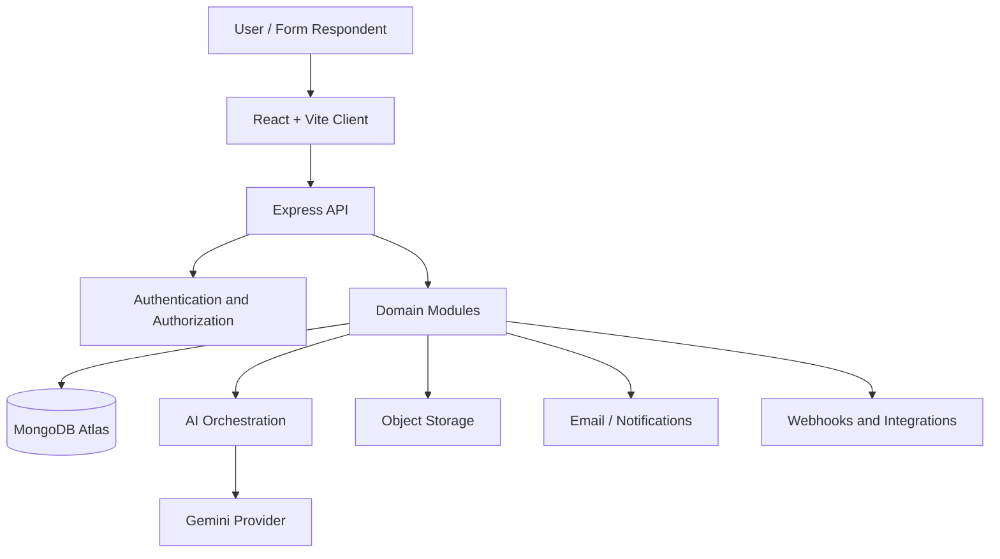

# Forma AI — Product and Application Architecture

## 1. Architecture goals

- Preserve the original schema-driven dynamic form engine.
- Expand into a coherent SaaS workspace.
- Reuse the current React, Express, MongoDB, and authentication foundations.
- Keep frontend and backend domains aligned.
- Support personal workspaces first while preparing for organization workspaces.
- Avoid premature microservices and unnecessary infrastructure.

## 2. System context



The frontend never calls an AI provider using a secret key. AI requests pass through the backend, where authentication, authorization, validation, rate limits, and context filtering are applied.

## 3. Frontend application layers

### App shell
- Router and route guards.
- Authenticated application layout.
- Shared sidebar and header.
- Theme provider and design tokens.
- Workspace context.
- Notification system.
- Floating assistant mounting point.
- Error boundaries and lazy-loaded routes.

### Feature domains
- Dashboard
- Forms
- Form renderer
- Responses
- Analytics
- Assistant and conversations
- Activity history
- Notifications
- Settings
- Onboarding
- Workspace and members
- Automation
- Billing (future)

### Shared frontend services
- API client with consistent error handling.
- Authentication/session service.
- Form and submission services.
- Assistant/conversation service.
- Theme and preference service.
- Shared validation schemas where appropriate.
- Reusable UI components and hooks.

Suggested target structure (adapt incrementally; do not move working files without checking imports and routes):

```text
src/
  app/
    App.jsx
    router.jsx
    providers/
    layouts/
  components/
    common/
    layout/
    forms/
    assistant/
    dashboard/
    onboarding/
  features/
    auth/
    dashboard/
    forms/
    responses/
    analytics/
    assistant/
    activity/
    notifications/
    settings/
    workspace/
    automation/
  pages/
  services/
  stores/
  hooks/
  styles/
  utils/
  assets/
```

## 4. Backend layers

Use a modular monolith. Each domain should own its routes, controller/handler, validation, service logic, and persistence model where practical.

Suggested target structure:

```text
backend/
  config/
  middleware/
  modules/
    auth/
    users/
    workspaces/
    members/
    forms/
    submissions/
    analytics/
    assistant/
    conversations/
    activity/
    notifications/
    onboarding/
    automation/
    billing/
  models/
  services/
    ai/
    email/
    storage/
    analytics/
    webhooks/
  routes/
  utils/
  app.js
  server.js
```

This is a target organization, not a claim that all these folders or modules currently exist. Migrate incrementally and preserve current API contracts unless a versioned change is planned.

## 5. Workspace and tenancy model

Recommended direction: individual-first, team-ready.

- Every authenticated user has access to a personal workspace.
- A user may later belong to multiple organization workspaces.
- Workspace membership determines role and permissions.
- Forms, submissions, conversations, activity, and settings should be workspace-scoped where relevant.
- Public respondents can submit to a published form without receiving workspace access.
- Every protected resource lookup must enforce workspace and resource authorization.

Suggested roles:
- Owner: full workspace control and ownership transfer.
- Admin: manage members, settings, and resources.
- Editor: create and manage permitted forms and data.
- Viewer: read permitted resources and reports.

Role names and exact permissions must be finalized before team functionality is implemented.

## 6. Key workflows

### Form lifecycle
Create → Configure schema → Validate → Preview → Save draft → Publish → Collect submissions → Analyze → Revise/version.

### Magic Input extraction
User text/document → authenticated API → extraction service → structured candidate values → schema validation → user review/correction → form submission.

### AI form generation
User prompt → backend assistant orchestration → structured schema output → strict schema validation → preview in Form Builder → user edits/approval → save draft or publish.

### Submission analysis
User selects an authorized form/dataset → backend verifies access and applies data minimization → aggregate or redact as appropriate → AI analysis → response with limitations and traceable metrics.

### Activity and notifications
Domain event → activity/notification service → persisted event/notification → user-facing history and notification centre.

## 7. API design principles

- Keep the existing `/api` prefix.
- Use consistent JSON response shapes and error formats.
- Validate path parameters, query parameters, and request bodies.
- Enforce authentication and resource authorization in backend middleware/services.
- Paginate large lists.
- Use explicit filters and date ranges for analytics.
- Add idempotency where duplicate submissions or repeated automation actions could cause harm.
- Do not trust workspace IDs supplied by the client without membership checks.
- Version breaking public API changes.

Existing route families include authentication, forms, extraction, conversations, and AI chat. Exact endpoint contracts must be confirmed from current route/controller code before changing them.

## 8. Cross-cutting services

- Authentication and authorization.
- Theme and user preferences.
- Workspace context.
- Audit/activity events.
- Notifications.
- AI provider abstraction and usage controls.
- File storage and validation.
- Logging and error reporting.
- Rate limiting and abuse prevention.

## 9. Scalability approach

Start with one Express deployment and MongoDB Atlas. Introduce background jobs, queues, caching, or separate services only when workload, latency, reliability, or operational evidence justifies them. Keep interfaces between domains clear so extraction is possible later.

## 10. Architecture decisions to validate

- Individual-first workspace creation and migration of existing user-owned data.
- Final role/permission matrix.
- Theme preference precedence between account, local device, and system.
- AI data retention and provider disclosure.
- Public form abuse controls.
- File storage provider and retention policy.
- Subscription entitlements and usage metering.
